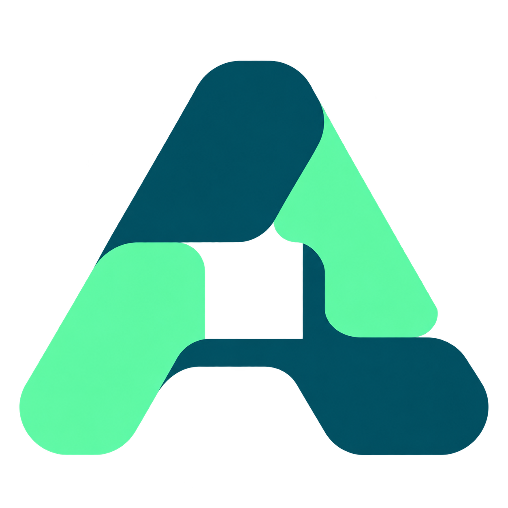

  

<h1 align="center">Agent Toolkit</h1>

<strong>El contexto de tu proyecto, compartido entre tus agentes.</strong>

Una memoria organizada · Varios agentes · Tú mantienes el control

## ¿Para qué sirve?

Cambias de chat o de asistente y vuelves a explicar el proyecto desde cero.
Las decisiones quedan dispersas, las notas envejecen y se repite trabajo que
ya estaba hecho.

Agent Toolkit ayuda a organizar ese contexto para que tus agentes encuentren
lo que necesitan, sepan dónde comprobarlo y puedan continuar con menos
explicaciones repetidas.

No es otro chatbot ni un agente que hace todo por su cuenta. Es una caja de
herramientas para conectar asistentes con una memoria de proyecto clara,
compartida y mantenible.

## Una memoria que puedes entender

**Obsidian sigue siendo parte del sistema.** Allí puedes leer y organizar las
notas del proyecto: su propósito, arquitectura, decisiones, avances y pendientes.
Son archivos de texto; no una memoria invisible que solo entiende una IA.

Los agentes consultan esa misma información mediante una conexión limitada.
Sus instrucciones les ayudan a buscar primero y leer solo lo pertinente.
El código y las pruebas del proyecto siguen siendo la fuente principal de
verdad: las notas explican el contexto, no lo sustituyen.

## Lo que puedes hacer hoy

- **Preparar una memoria nueva** con una estructura común, sin copiar los datos
  de otro proyecto ni sobrescribir archivos distintos.
- **Conectar Codex, Claude Code y Gemini CLI** mediante sus configuraciones
  locales de Skills y acceso de lectura. Cada conexión requiere comprobarse
  también en el cliente real.
- **Detectar problemas** en la estructura, los enlaces, la configuración y
  posibles secretos antes de seguir trabajando.
- **Consultar el estado** de la memoria y de las conexiones declaradas.
- **Encontrar cambios integrados en GitHub** que aún no aparecen como revisados
  en el registro de la memoria.
- **Reunir evidencia de un cambio**: qué archivos afectó, qué comprobaciones
  tiene y qué áreas de las notas conviene revisar.

También incluye procedimientos reutilizables para definir requisitos,
documentar decisiones, revisar calidad y pasar trabajo entre sesiones, junto
con perfiles especializados de exploración, análisis y tutoría.

## Cómo encaja en tu trabajo

1. **Organizas el proyecto.** Su código vive en su repositorio y su contexto en
   una memoria independiente.
2. **Conectas tus asistentes.** Consultan las notas relevantes y contrastan las
   afirmaciones con las fuentes del proyecto.
3. **Desarrollas y revisas los cambios.** Una rama en progreso no se presenta
   como comportamiento ya integrado.
4. **Revisas el impacto en la memoria.** Las herramientas actuales detectan e
   inspeccionan cambios; una persona o un agente autorizado decide qué notas
   deben actualizarse.

La consulta de memoria está separada de su escritura. La CLI todavía no edita
automáticamente las notas ni marca revisiones como completadas.

## Pensado para más de un proyecto

Agent Toolkit contiene las herramientas generales. Cada proyecto conserva su
propia memoria, instrucciones y límites de acceso.

Puedes reutilizar la estructura sin llevarte las decisiones, documentos
privados o credenciales de un proyecto a otro. Clonar esta biblioteca tampoco
clona las memorias ni conecta automáticamente los agentes.

## Control y límites claros

- Las conexiones de memoria se preparan con herramientas de **solo lectura**.
- Crear memorias y conexiones tiene una vista previa; aplicar cambios exige
  una acción explícita.
- No se deben guardar contraseñas, tokens, credenciales ni datos personales en
  las memorias. Las comprobaciones ayudan, pero no garantizan detectar todo.
- La herramienta se detiene ante los conflictos que comprueba; no intenta
  resolverlos sobrescribiendo archivos.
- No instala un sistema de permisos sin restricciones ni garantiza que todos
  los clientes se comporten igual.

## En qué punto está

**Base funcional en desarrollo · versión 0.1.0.** Hay 101 pruebas automatizadas
aprobadas en la revisión local del 1 de octubre de 2026 y una inspección real
de GitHub documentada. Eso no equivale a una certificación de producción ni a
compatibilidad probada en todos los sistemas operativos.

| Etapa | Estado |
| --- | --- |
| Crear, diagnosticar y conectar memorias | Implementado |
| Consultar el estado de las conexiones | Implementado |
| Detectar e inspeccionar cambios fusionados | Implementado |
| Registrar revisiones sin duplicarlas | Especificación propuesta |
| Actualizar notas con autorización y verificaciones | Pendiente |
| Integrar el ciclo completo con una automatización | Pendiente |
| Elegir modos tutor y autónomo | Propuesta separada; no activada |
| Búsqueda semántica y nuevos proveedores | Evolución posterior, no comprometida |

El objetivo de la primera versión completa es cerrar el ciclo de revisión y
mantenimiento con controles. Las capacidades avanzadas se añadirán cuando
resuelvan una necesidad comprobada, no como requisitos para empezar.

## ¿Quieres usarlo o entender cómo está construido?

- [Guía de uso e instalación](docs/uso.md): comandos y conexiones locales.
- [Arquitectura del sistema](docs/project-memory-system.md): separación de
  herramientas, código y memoria.
- [Siguiente etapa: registro de revisiones](docs/project-memory-sync-record.md):
  propuesta de comportamiento antes de implementarlo.
- [Identidad visual](assets/brand/README.md): concepto y origen del logo.

La biblioteca se respalda en GitHub como repositorio privado. No incluye las
bóvedas de los proyectos ni publica su contenido.
