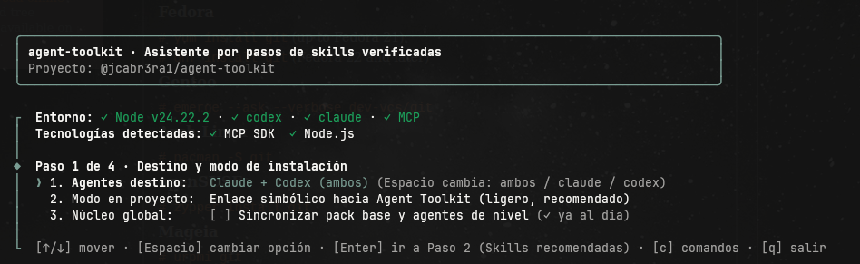

<p align="center">
  
</p>

<h1 align="center">NexaKit</h1>

<p align="center">
  <strong>Skills verificadas por SHA-256, coordinación entre agentes y memoria por proyecto para Claude Code y Codex.</strong>
</p>

<p align="center">
  <code>$ npx nexakit</code>
</p>

<p align="center">
  <sub>Node.js &gt;= 24 · Claude Code &amp; Codex · Aislado en <code>.agent-toolkit/</code> · Licencia MIT</sub>
</p>

<p align="center">
  
</p>

---

## Inicio rápido

Con **Node.js 24+** instalado, abre cualquier proyecto en tu terminal y ejecuta:

```bash
# Ejecutar al vuelo sin instalar nada antes (estilo AutoSkills)
npx nexakit

# O instalarlo globalmente para invocarlo al instante con `nexakit` (o el alias `agent-toolkit`)
npm install -g nexakit
nexakit
```

---

## Cómo funciona el asistente en 4 pasos

Al lanzar `npx nexakit` en la raíz de cualquier repositorio se abre el asistente interactivo en terminal:

| Paso | Qué decide | Garantía |
| --- | --- | --- |
| **1. Destino, modo y Git** | Elige `Claude + Codex`, **enlace simbólico** o **copia verificada** (`.agent-toolkit/skills-lock.json`), y si ignorar en `.gitignore` o en `.git/info/exclude`. | Estado 100 % aislado bajo `.agent-toolkit/` sin ensuciar la raíz ni `git status`. |
| **2. Skills fundamentales** | Detecta el stack real (`package.json`, `tsconfig.json`) y premarca solo las skills que encajan. | Cada archivo se comprueba en vivo por **SHA-256** frente al catálogo auditado. |
| **3. Opcionales y añadidos** | Muestra aparte las skills fuera del stack detectado y complementos opcionales como [`obra/superpowers`](docs/skills/superpowers-integration.md). | Sin descargas silenciosas ni contaminación del contexto global. |
| **4. Vista previa segura** | Lista cada enlace, copia y regla de ignore antes de escribir; `[d]` desacopla todo cuando quieras. | Nunca sobrescribe archivos propios ni habilidades modificadas localmente. |

---

## Catálogo incluido (10 skills verificadas por SHA-256)

Todas las skills empaquetadas están fijadas por commit de 40 caracteres y verificadas en [`catalogs/skills.json`](catalogs/skills.json):

| Área | Skills incluidas | Señales detectadas |
| --- | --- | --- |
| **Frontend & UI** | `vercel-react-best-practices`, `vercel-composition-patterns`, `frontend-design`, `web-design-guidelines`, `webapp-testing` | `React`, `Next.js`, `Tailwind CSS`, `Astro`, `Vue`, `Svelte`, `Playwright` |
| **Backend & APIs** | `nodejs-backend-patterns`, `api-design-principles` | `Express`, `Fastify`, `Hono` |
| **Bases de datos** | `supabase-postgres-best-practices` | `Supabase`, `PostgreSQL`, `Drizzle`, `Prisma` |
| **MCP & Seguridad** | `mcp-builder`, `differential-review` | `@modelcontextprotocol/sdk`, `fastmcp`, revisión diferencial |

Además, el núcleo global incorpora el flujo disciplinado de desarrollo y coordinación entre agentes:

| Comando en Claude | Comando en Codex | Función |
| --- | --- | --- |
| `/spec-driven-development` | `$spec-driven-development` | Especificación concisa, alternativas y plan verificable antes de tocar código. |
| `/programar` | `$programar` | Implementación guiada (modo tutor paso a paso o autónomo). |
| `/desarrollo-con-pruebas` | `$desarrollo-con-pruebas` | Ciclo estricto Rojo → Verde → Refactorizar comprobando el fallo inicial. |
| `/depurar` | `$depurar` | Aislamiento de causa raíz reproducible antes de proponer un parche. |
| `/quality-gate` | `$quality-gate` | Puerta de calidad con evidencia fresca ejecutada antes de dar por cerrado un trabajo. |
| `/revisar` | `$revisar` | Revisión cruzada independiente entre sesiones de Claude Code y Codex. |
| `/estado` · `/cerrar-memoria` | `$estado` · `$cerrar-memoria` | Consulta y cierre ordenado sobre la bóveda de memoria del proyecto. |

---

## Comandos principales de terminal

```bash
npx nexakit                             # Abre el asistente interactivo de 4 pasos (tecla [c] abre la chuleta)
npx nexakit recommend --project .       # Inspecciona el stack en solo lectura (--json disponible)
npx nexakit detach --project .          # Vista previa segura para desacoplar el proyecto
npx nexakit detach --project . --apply  # Retira skills acopladas, .agent-toolkit/ y bloque de Git ignore
npx nexakit doctor --agent all          # Verifica Node, clientes, enlaces globales, MCP y sandbox de Codex
npx nexakit setup --agent all --apply   # Enlaza el núcleo global en ~/.claude/skills y ~/.agents/skills
agent-toolkit-inbox consumo             # Resumen local de consumo por agente y fase
```

> Todos los subcomandos aceptan también el binario compatible `agent-toolkit`.

---

## Memoria privada por proyecto (`project-memory`)

El código sigue siendo la fuente de verdad; la memoria de largo plazo vive en una carpeta separada y se conecta en solo lectura mediante MCP tras revisar su vista previa:

```bash
# 1. Vista previa sin escribir en disco (añade --apply para crearla)
project-memory init ../memoria-mi-proyecto \
  --project-id mi-proyecto \
  --project-name "Mi Proyecto" \
  --source /ruta/a/mi-proyecto

# 2. Diagnosticar y conectar en Claude o Codex (vista previa primero, luego --apply)
project-memory doctor ../memoria-mi-proyecto
project-memory connect ../memoria-mi-proyecto --agent codex --apply
project-memory status ../memoria-mi-proyecto
```

---

## Desarrollo local y publicación en npm

<details>
<summary><strong>Modo desarrollo local (clonado, enlace y pruebas)</strong></summary>

```bash
git clone https://github.com/Jcabr3ra1/agent-toolkit.git
cd agent-toolkit
npm ci --ignore-scripts
npm link --ignore-scripts
npm test
```

- Para desvincular el enlace global de desarrollo: `npm uninstall -g nexakit`.
- `npm pack` ejecuta `prepack` y copia `package-lock.json` en `assets/runtime/package-lock.json` para el verificador experimental; no la edites a mano.
- En Windows se omiten comprobaciones POSIX de propietario/modo y se aplican permisos del usuario actual (`AGENT_TOOLKIT_QUIET_PLATFORM_WARNINGS=1` silencia el aviso).
</details>

<details>
<summary><strong>Publicar una versión en <code>npmjs.com</code></strong></summary>

```bash
npm login
npm run prepack
npm publish --access public
```
</details>

---

## Documentación

El [índice completo de documentación](docs/README.md) agrupa todas las guías y especificaciones:

| Necesito… | Guía |
| --- | --- |
| Usar el asistente por pasos, `.agent-toolkit/` y `detach` | [Recomendador y asistente de skills](docs/skills/recomendador.md) |
| Consultar catálogo y licencias de origen | [Fuentes de skills](docs/skills/fuentes-de-skills.md) · [Integración Superpowers](docs/skills/superpowers-integration.md) |
| Recorrido completo de comandos y MCP | [Guía de comandos](docs/guias/guia-de-comandos.md) · [Consolidación](docs/guias/consolidacion.md) |
| Probar con datos ficticios sin tocar proyectos reales | [Primeros pasos](docs/guias/primeros-pasos.md) · [Guía de uso](docs/guias/uso.md) |
| Crear, conectar y diagnosticar memorias | [Init](docs/memoria/project-memory-init.md) · [Connect](docs/memoria/project-memory-connect.md) · [Status](docs/memoria/project-memory-status.md) · [Arquitectura](docs/memoria/project-memory-system.md) |
| Coordinar encargos y revisión cruzada | [Preparar encargos](docs/agentes/coordinacion/agent-task-prepare.md) · [Verificar entregas](docs/agentes/coordinacion/agent-task-verify.md) · [Revisión cruzada](docs/agentes/coordinacion/peer-review-workflow.md) |
| Consultar herramientas de Gemini e identidad visual | [Herramientas de Gemini](docs/guias/herramientas-gemini.md) · [Identidad de marca](assets/brand/README.md) |

## Licencia y cuidado de datos

- Publicado bajo licencia [MIT](LICENSE); las skills adaptadas e incorporadas conservan íntegras sus licencias de origen (`MIT`, `Apache-2.0`, `CC-BY-SA-4.0`) en sus directorios.
- Nunca guardes contraseñas, tokens ni credenciales en memorias de proyecto ni en `.npmrc` versionados.
- Toda instalación, conexión o desacoplado ofrece vista previa segura antes de escribir y respeta cualquier archivo creado o modificado por el usuario.
