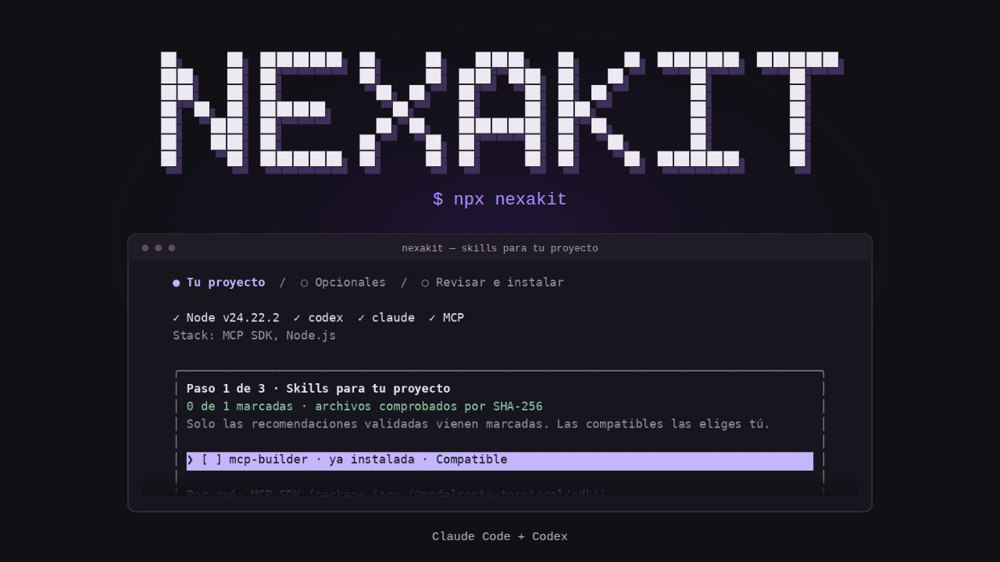

<div align="center">



# NexaKit

**Tus skills. Tus agentes. Un mismo flujo.**

[Documentación](docs/README.md) · [Catálogo](catalogs/skills.json) · [Guía de uso](docs/skills/recomendador.md)

</div>

Detecta las tecnologías de tu proyecto, encuentra skills compatibles y revisa cada cambio antes de instalar. Para **Claude Code y Codex**.

```bash
npx nexakit
```

## Cómo funciona

1. **Revisa las skills para tu proyecto.** Cada sugerencia explica por qué encaja y para qué puede servir.
2. **Añade las opcionales.** Marca lo que necesitas; las recomendaciones con escenarios validados se seleccionan inicialmente cuando requieren instalación.
3. **Confirma la instalación.** Revisa agentes, modo, reglas de Git y archivos previstos antes de aplicar los cambios.

`↑` / `↓` para moverte, `Espacio` para marcar, `Enter` para continuar. En la revisión, `e` edita la configuración y `Esc` cancela sin modificar el proyecto.

## Skills con contexto

El catálogo incluido contiene **10 skills** con revisión de origen y hashes SHA-256. NexaKit muestra el motivo de cada sugerencia, su utilidad prevista y los solapamientos con otras skills.

Una skill **compatible** coincide con tu tecnología o perfil. Una **recomendada** también necesita un escenario funcional pasado para cada agente destino. Los hashes comprueban integridad; las entradas actuales aún no tienen escenarios funcionales validados.

Las skills se obtienen del catálogo local incluido en el paquete. Consulta las [fuentes y licencias](docs/skills/fuentes-de-skills.md) o aprende a [ampliar el catálogo](docs/skills/ampliar-catalogo.md).

## Comandos

```bash
npx nexakit                              # Abrir el asistente
npx nexakit recommend --project .        # Consultar sugerencias sin modificar archivos
npx nexakit doctor --agent all           # Comprobar el entorno
npx nexakit detach --project .           # Revisar qué se retiraría del proyecto
npx nexakit detach --project . --apply   # Aplicar el desacoplado
```

También puedes instalarlo con `npm install -g nexakit` y ejecutar `nexakit`. El alias `agent-toolkit` sigue disponible.

## Tecnologías detectadas

- **Frontend:** React, Next.js, Tailwind CSS, Astro, Vue y Svelte.
- **APIs:** Express, Fastify y Hono.
- **Datos:** Supabase, PostgreSQL, Prisma y Drizzle.
- **MCP:** SDK de Model Context Protocol y FastMCP.
- **Pruebas:** Playwright. Node.js, TypeScript y Vitest también se reconocen como señales del proyecto, aunque no tienen una skill específica asignada por sí solos.

## Más herramientas

- **Coordinación entre agentes.** Implementación y revisión cruzada con Claude Code y Codex. [Guía de comandos](docs/guias/guia-de-comandos.md).
- **Memoria por proyecto.** Contexto separado del código y conectado en solo lectura mediante MCP. [Crear una memoria](docs/memoria/project-memory-init.md).
- **Catálogo ampliable.** Incorpora skills y comprueba sus archivos con `npm run catalog:validate`. [Añadir una skill](docs/skills/ampliar-catalogo.md).

## Requisitos

**Node.js 24 o superior** y una terminal interactiva para el asistente.

Para contribuir: [desarrollo local, pruebas y empaquetado](docs/guias/desarrollo.md).

## Licencia

[MIT](LICENSE). Las skills incorporadas conservan sus licencias originales.
